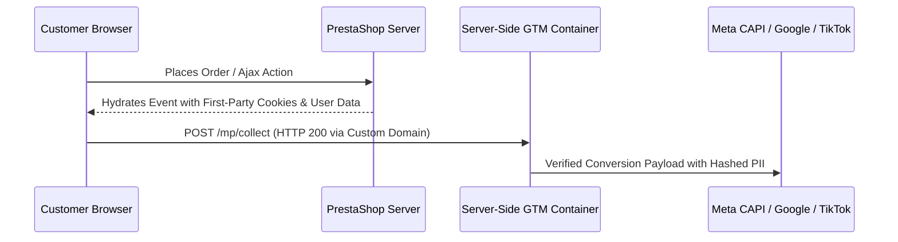

# 05. Server-Side Transport, Webhooks & Offline Conversions

## 1. Server-Side GTM (sGTM) Transport Architecture

Server-Side Google Tag Manager acts as a privacy proxy between the user's browser and downstream advertising networks.



### Benefits:
- First-party cookie context (`SameSite=Lax`, `Secure`).
- Complete circumvention of ad-blockers and browser tracking restrictions (ITP).
- Enrichment with server-verified order data before network dispatch.

---

## 2. Customer User Data & SHA-256 Normalization

All major advertising platforms (Meta Advanced Matching, TikTok Advanced Matching, Google Enhanced Conversions, Pinterest Enhanced Match) require customer PII to be normalized before hashing:

### The Normalization Standard:
1. **Email**: Strip leading/trailing whitespaces, convert all characters to lowercase, then SHA-256 hash.
2. **Phone Number**: Strip all non-numeric characters (hyphens, spaces, parentheses), prepend international country code (E.164 format e.g. `+491701234567`), then hash.
3. **Names & City**: Lowercase, strip accents/diacritics, trim whitespace.
4. **Postal Code**: Lowercase, strip internal spaces.

```php
class CustomerDataEngine
{
    public static function hashField($val)
    {
        $clean = trim(mb_strtolower((string)$val, 'UTF-8'));
        return (!empty($clean)) ? hash('sha256', $clean) : '';
    }

    public static function normalizePhone($phone, $countryIso = 'DE')
    {
        $clean = preg_replace('/[^0-9+]/', '', (string)$phone);
        if (strpos($clean, '00') === 0) {
            $clean = '+' . substr($clean, 2);
        }
        return self::hashField($clean);
    }
}
```

---

## 3. Server-Side Webhook Dispatcher with HMAC Signature

When sending conversion data from PrestaShop backend to external endpoints or webhooks, secure the payload using HMAC SHA-256:

```php
class ServerSideWebhookDispatcher
{
    public static function dispatch($endpoint, array $payload, $secretKey = '')
    {
        $json = json_encode($payload, JSON_UNESCAPED_SLASHES | JSON_UNESCAPED_UNICODE);
        $headers = [
            'Content-Type: application/json',
            'User-Agent: PrestaShop-ServerSide-Dispatcher/1.0',
        ];

        if (!empty($secretKey)) {
            $sig = hash_hmac('sha256', $json, $secretKey);
            $headers[] = 'X-PrestaShop-Signature: ' . $sig;
        }

        $ch = curl_init($endpoint);
        curl_setopt($ch, CURLOPT_POST, true);
        curl_setopt($ch, CURLOPT_POSTFIELDS, $json);
        curl_setopt($ch, CURLOPT_RETURNTRANSFER, true);
        curl_setopt($ch, CURLOPT_TIMEOUT, 5);
        curl_setopt($ch, CURLOPT_HTTPHEADER, $headers);
        $res = curl_exec($ch);
        $code = curl_getinfo($ch, CURLINFO_HTTP_CODE);
        curl_close($ch);

        return ($code >= 200 && $code < 300);
    }
}
```
